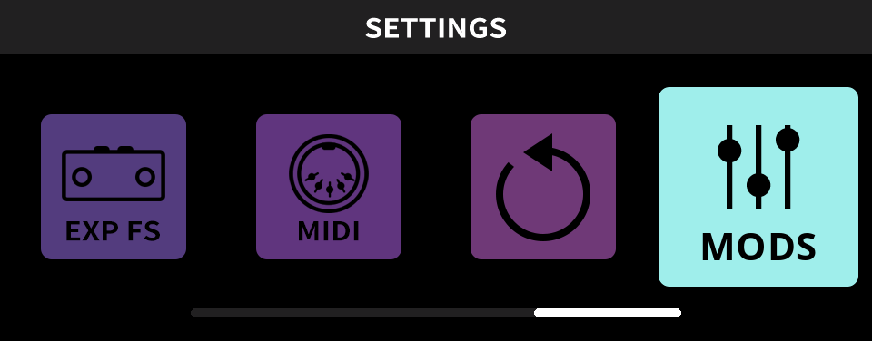
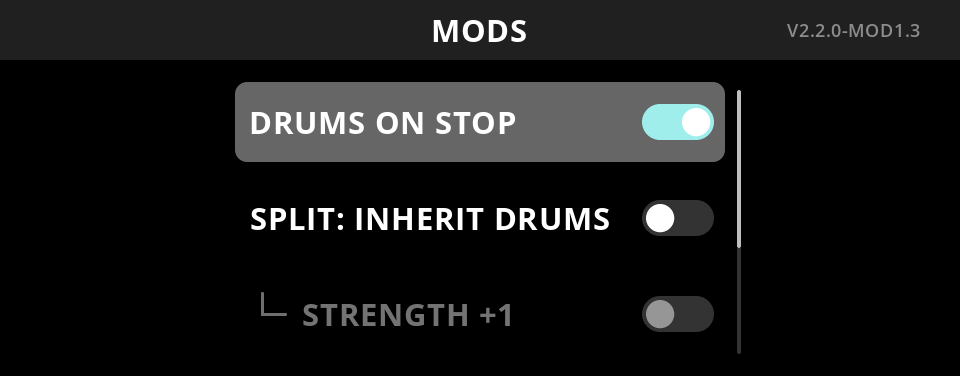

# Better Dual Loop

An unofficial firmware mod for the [NUX Dual Loop Stereo](https://nuxaudio.com/product/dualloopstereo/) (NML-3DLS) looper pedal.

**[The page](https://aisus.github.io/better-dual-loop/)**: patch the firmware, put your own drum patterns on the pedal, get the stock ones as MIDI files.

<b>AI usage disclaimer</b>

This project was made by reverse engineering the firmware with [Ghidra](https://github.com/NationalSecurityAgency/ghidra) and an AI coding assistant (Claude Code).

The author does not claim the expertise in embedded software and reverse engineering needed to build this without AI tools, or to verify that the way the firmware is modified is optimal.

## Mods

  
  

Switches on the new MODS page of the settings menu (V2.2.0-MOD1.3), all off by default. Off, the pedal behaves like the official firmware, apart from the [always-on changes](#always-on).

| Switch | Off (stock) | On |
|---|---|---|
| **DRUMS ON STOP** | Stopping a loop also stops the drums. | The drums keep playing after the loop stops. DRUM ON/OFF stops them. |
| **SPLIT: INHERIT DRUMS** | In A/B mode, the second loop has its own drums: drums started with the first loop stop when you record the second. | Until recorded, the second loop takes the first loop's drums: on/off, drum set and groove. |
| &nbsp;&nbsp;**STRENGTH +1** | The second loop gets the first loop's groove. | The second loop gets the first loop's groove one strength higher. |
| &nbsp;&nbsp;**VARIATION +1** | The second loop gets the first loop's groove. | The second loop gets the first loop's groove one variation further. |
| **SYNC: FS PER LOOP** | In A+B mode, footswitch 1 works on the selected loop and footswitch 2 selects the loop. | Footswitch 1 works on loop 1 and footswitch 2 on loop 2, as in A/B mode. |

Details:
- DRUMS ON STOP works for every way a loop stops: CTRL, an external footswitch, every STOP MODE.
- DRUMS ON STOP also keeps each recorded loop's drums. For example: a loop plays with drums, you stop the loop, then the drums with DRUM ON/OFF. When you start the loop again, its drums start with it. A recorded loop's drums change only while it plays or on the drum page.
- SPLIT: INHERIT DRUMS: pressing DRUM ON/OFF, or choosing a drum set or groove, while the empty loop is selected gives it its own drums instead. The tempo is always shared.
- SPLIT: INHERIT DRUMS (or DRUMS ON STOP) also fixes an official firmware issue: saving a memory slot again with a loop unchanged stored the selected loop's drum on/off for it.
- STRENGTH +1 and VARIATION +1 are part of SPLIT: INHERIT DRUMS: switching one on switches it on too. With both on, a first loop on groove 2.1 gives the second loop 3.2, one cell up and right on the drum page's grid. At the grid's edge the groove stays (4.4 stays 4.4). The step goes to the loop recorded second, whichever it is.
- SYNC: FS PER LOOP: each footswitch does what footswitch 1 does in A+B mode (record, play, dub, undo, stop, clear) on its own loop, and its LED shows that loop. The same for an external footswitch set to act as footswitch 1 or 2. CTRL is unchanged.

### Always on

| Change | Stock | Patched |
|---|---|---|
| **Red delete screen** | The memory slot's delete confirmation looks like the save one, so a SAVE held too long is easily confirmed as a delete. | The delete confirmation is red. |
| **Drum patterns** | Stock drum patterns. | Patterns put on the pedal with the page replace the stock ones (see [Drum patterns](#drum-patterns)). |
| **A+B mode: recording start** | A loop recorded while the other plays, pressed slightly late (in the first beat of the bar), plays one bar off against the other loop. | The new loop plays where it was recorded. |
| **A/B mode: drums of a loop started at once** | Recording a loop just as the other comes round (in its first beat) starts it at once, but with the other loop's drums. | The new loop plays its own drums. |
| **A/B mode: CTRL after recording** | Recording a loop just as the other comes round leaves CTRL's single press doing nothing until another footswitch is pressed. | CTRL works as usual. |

## Drum patterns

The page's **Drum patterns** replaces any of the pedal's drum patterns with your MIDI clips: pick a style and a cell of its grid (strength and variation, as on the pedal's drum page), drop a clip of 1 to 8 bars, save to the pedal and restart it. Needs the mod and Chrome or Edge on a computer.

- Clips use General MIDI drum notes (the page lists the 13 the pedal's kits have). The style's kit and tempo stay.
- All your patterns are in one file, `NML-3DLS/DRUM/PATTERNS.BIN`. To get the stock drums back, revert the cells and save, or delete the file. The official firmware ignores it.
- The **MIDI extractor** turns NUX's official zip into MIDI files of all 672 stock patterns (`01 ROCK-1/4-4/ROCK-1-44-2.3.mid`). The patterns are NUX's: for your own use.

## Using it

1. Download firmware **V2.2.0** from [NUX's website](https://nuxaudio.com/product/dualloopstereo/), the only supported version, and keep the zip.
2. Drop the zip on [the patcher](https://aisus.github.io/better-dual-loop/#/patcher) and download the result.
3. Flash it with NUX's updater, following the steps on the page (NUX's standard update procedure).

To go back, flash `NML-3DLSFirmwareV2.2.0.bin` from the NUX zip the same way. Loops, settings and the boot GIF are kept either way.

Everything runs in the browser, nothing is uploaded. Flashing is tested on Windows. NUX's macOS updater should work the same way but is untested. NUX has no updater for Linux.

## How it works

The page runs the patch (`patch/`) on your file:

1. It checks that the file is the official V2.2.0 image, by its SHA-256.
2. It adds our code, compiled from `mods/`, after NUX's code, and routes these firmware calls through it:
   - The settings menu's drawing, knobs and buttons: adds the MODS tile and page, passes the rest on.
   - The 11 places where stopping a loop also stops the drums (DRUMS ON STOP).
   - Saving a loop's drum settings, and the drum page's DRUM 1/2 tab: passes the drums to loops not recorded yet (SPLIT: INHERIT DRUMS, with the +1 steps), keeps recorded loops' drums while all loops are stopped (DRUMS ON STOP). Loading a memory slot clears the empty loops' own choices.
   - Restarting the drums when a loop starts while the other is stopped: in A+B mode, as that loop last played (DRUMS ON STOP).
   - Saving a memory slot: each loop's drum on/off from its own settings, not from the drums playing (SPLIT: INHERIT DRUMS in A/B mode, or DRUMS ON STOP).
   - Footswitches 1 and 2 in A+B mode, and the footswitch LEDs (SYNC: FS PER LOOP).
   - Recordings starting at a bar line or, in A/B mode, at once: sets the first beat, the active loop and its drums (always on).
   - Every start: reads `NML-3DLS/DRUM/PATTERNS.BIN`, checks each pattern and writes `STATUS.TXT` next to it. The drum clock then takes a pattern from the file over the stock one.
   - The memory slot dialog's colours: red for delete.
3. It adds our pictures (`images/`) for the MODS tile and page, and stacks the release lines under the NUX logo on the boot screen.
4. It updates the image's sizes and checksums, and moves the space kept for a custom boot GIF past the added pictures.
5. It checks that the result is exactly the image tested on the pedal, by its SHA-256.

The patched image is written only to the firmware area. The bootloader's update mode, which the official updater uses, is not changed, so the official firmware can always be flashed back.

Every change, with its firmware address and a comment: [`patch/mods.js`](patch/mods.js).

## Repository

| Path | Contents |
|---|---|
| `web/` | The page, a Vue app: `pages/` and `components/` (TypeScript), `state/` (what they show), `patcher.js`, `extractor.js` and `zip.js` (your file in and out) |
| `drum/` | Drum patterns: the file the pedal reads (`patterns.js`), MIDI in and out (`midi.js`), the styles, the pedal's drive, the stock patterns from NUX's firmware (`stock.js`) |
| `patch/` | The patch the page runs: the firmware's file format, and every change (`mods.js`) |
| `mods/` | The C source of the added code. `fw.h` and `firmware.ld` name the firmware functions and data it uses |
| `images/` | The added pictures, as they go into the firmware (BMP) |
| `release.json` | The version and SHA-256 checksums: official input, our compiled code, output |
| `tests/` | Tests on synthetic data, no NUX firmware needed |

Run `npm ci` first (Node 22.13+). Then:
- `npm test` runs the tests
- `npm run lint` runs ESLint and Prettier (`npm run format` fixes the formatting)
- `npm run build` checks the types and builds the page into `build/site/`, as one readable script (run `make` first)
- `npm run dev` serves the page on <http://localhost:8000/>, reloading on changes

`make` compiles `mods/` with the [Arm GNU Toolchain 14.2.rel1](https://developer.arm.com/downloads/-/arm-gnu-toolchain-downloads) (`make TOOLCHAIN=<its folder>` if it is not on the PATH). The deploy builds it the same way and stops if its SHA-256 differs from `release.json`.

The pictures use the [Open Sans](https://fonts.google.com/specimen/Open+Sans) typeface.

## Support

A hobby project, tested on one pedal. Issues (bugs, reports from other devices, feature requests) and contributions are welcome. Fixes are best effort, and a port to a newer NUX firmware is not promised.

## Legal

Provided as is, without warranty. Flashing modified firmware is at your own risk. This project is not affiliated with or endorsed by NUX / Cherub Technology. NUX, Dual Loop Stereo and other product names are trademarks of their owners. No NUX firmware is included here: the page uses the file you provide.

Licence: MIT, see [LICENSE](LICENSE).
