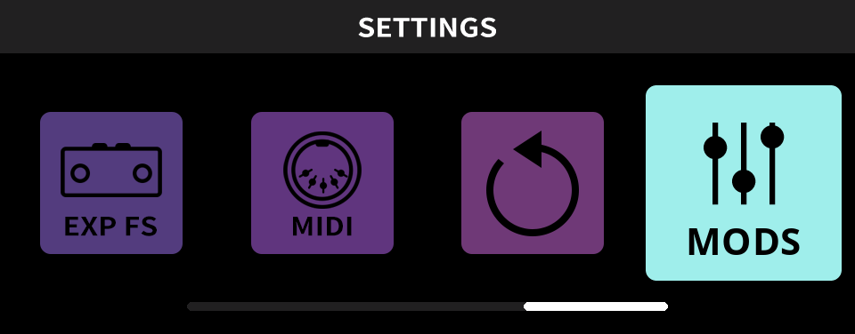
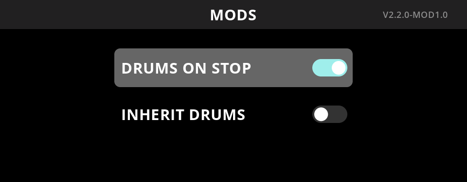

# Better Dual Loop

An unofficial firmware mod for the [NUX Dual Loop Stereo](https://nuxaudio.com/product/dualloopstereo/) (NML-3DLS) looper pedal.

**[Patch the firmware in your browser](https://aisus.github.io/better-dual-loop/)**

<b>AI usage disclaimer</b>

The code in this project is the result of an involved reverse-engineering process done with the [Ghidra](https://github.com/NationalSecurityAgency/ghidra) framework and an AI coding assistant (Claude Code).

The author does not claim the expertise in embedded software and reverse engineering needed to build a similar solution without AI tools, or to verify that the way the firmware is modified is optimal.

Each modification is the result of many iterations of on-device testing and tweaking, but was only tried on one real pedal. Everything is provided as is, with no guarantee. Using this patch on your device is your own responsibility.

If you have the expertise to improve the solution, contributions are very welcome.

## Mods

  
  

Modifications in the new MODS settings menu (V2.2.0-MOD1.0):

| Switch | Default | Patched |
|---|---|---|
| **DRUMS ON STOP** | Stopping a loop also stops the drum machine. | The drums keep playing after stopping the loop; only DRUM ON/OFF stops them. |
| **INHERIT DRUMS** | In A/B mode each loop has its own drum on/off: drums started with the first loop stop when you record the second. | If the first loop is recorded with the drums, the second loop has them on too. |

Everything is off by default, which behaves exactly like the official firmware.

Details:
- DRUMS ON STOP covers every way a loop stops: CTRL, external footswitch, any STOP MODE (LOOP END, ONE SHOT, FADE OUT).
- INHERIT DRUMS: pressing DRUM ON/OFF while a loop not recorded yet is selected counts as an explicit choice for that loop, which it keeps instead.
- Unchanged official behaviour: in A/B mode, after reloading a saved memory slot, the second loop follows the first loop's drum on/off.

## Using it

1. Download firmware **V2.2.0** from [NUX's website](https://nuxaudio.com/product/dualloopstereo/) and keep the zip: this release modifies only V2.2.0.
2. Open [the page](https://aisus.github.io/better-dual-loop/), drop the zip on it and download the result.
3. Flash it with NUX's updater, as described on the page: it is the standard update procedure from NUX's firmware update guide.

To go back, flash `NML-3DLSFirmwareV2.2.0.bin` from the NUX zip the same way. Your loops, settings and boot GIF are kept either way.

The page accepts only the official V2.2.0 image and produces only the exact image that was tested on the pedal, both checked by SHA-256. Your file is processed in your browser and never leaves your computer. Flashing was tested on Windows. NUX's macOS updater should work the same way but is not tested. NUX has no updater for Linux.

## How it works

The page runs the patch (`patch/`) on your file, in your browser:

1. It checks that your file is the official V2.2.0 image, by its SHA-256.
2. It adds our code, compiled from `mods/`, right after NUX's code, and points the firmware to it:
   - The settings menu's drawing, knobs and buttons go through our code, which adds the MODS tile and page and passes everything else on unchanged.
   - The 11 places where stopping a loop also stops the drums call our code instead.
   - When a loop's drum settings are saved, our code passes the drum on/off on to the loops not recorded yet, unless DRUM ON/OFF was pressed for them.
3. It adds our pictures (`images/`) for the MODS tile and page, and stacks the release lines under the NUX logo on the boot screen.
4. It updates the image's sizes and checksums, and moves the space the pedal keeps for a custom boot GIF past the added pictures.
5. It checks that the result is exactly the image that was tested on a pedal, by its SHA-256.

The patched image is written only to the firmware area. The bootloader's update mode, which the official updater uses, is never touched, so the pedal can always go back to the official firmware.

Every change, with its address in the firmware and a short comment: [`patch/mods.js`](patch/mods.js).

## Repository

| Path | Contents |
|---|---|
| `web/` | The page |
| `patch/` | The patch the page runs: the firmware's file format, and every change (`mods.js`) |
| `mods/` | The C source of the code the mod adds; `fw.h` and `firmware.ld` name the firmware functions and data it uses |
| `images/` | The pictures the mod adds, exactly as they go into the firmware (BMP) |
| `release.json` | The version and SHA-256 checksums: official input, our compiled code, output |
| `tests/` | Tests on synthetic data, no NUX firmware needed |

Run `npm ci` first (Node 22.13+). Then:
- `npm test` runs the tests
- `npm run lint` checks the JavaScript with ESLint and its formatting with Prettier (`npm run format` fixes the formatting)
- `npm run build` assembles the page in `build/site/` (run `make` first, see below)
- `npm run dev` serves the page on <http://localhost:8000/>, rebuilt and reloaded on every change (also after `make`).

`make` compiles `mods/` with the [Arm GNU Toolchain 14.2.rel1](https://developer.arm.com/downloads/-/arm-gnu-toolchain-downloads) (`make TOOLCHAIN=<its folder>` if it is not on the PATH).
Every deploy does the same and stops if the result differs from `release.json`.

The pictures use the [Open Sans](https://fonts.google.com/specimen/Open+Sans) typeface.

## Support

A hobby project, tested on one pedal. Issues (bugs, reports from other devices, feature requests) are welcome. Fixes come on a best-effort basis, with no promise of a port to a newer NUX firmware.

## Legal

Provided as is, without warranty. Flashing modified firmware is at your own risk. This project is not affiliated with or endorsed by NUX / Cherub Technology. NUX, Dual Loop Stereo and other product names are trademarks of their owners. No NUX firmware is included here: the page uses the file you provide.

Licence: MIT, see [LICENSE](LICENSE).
